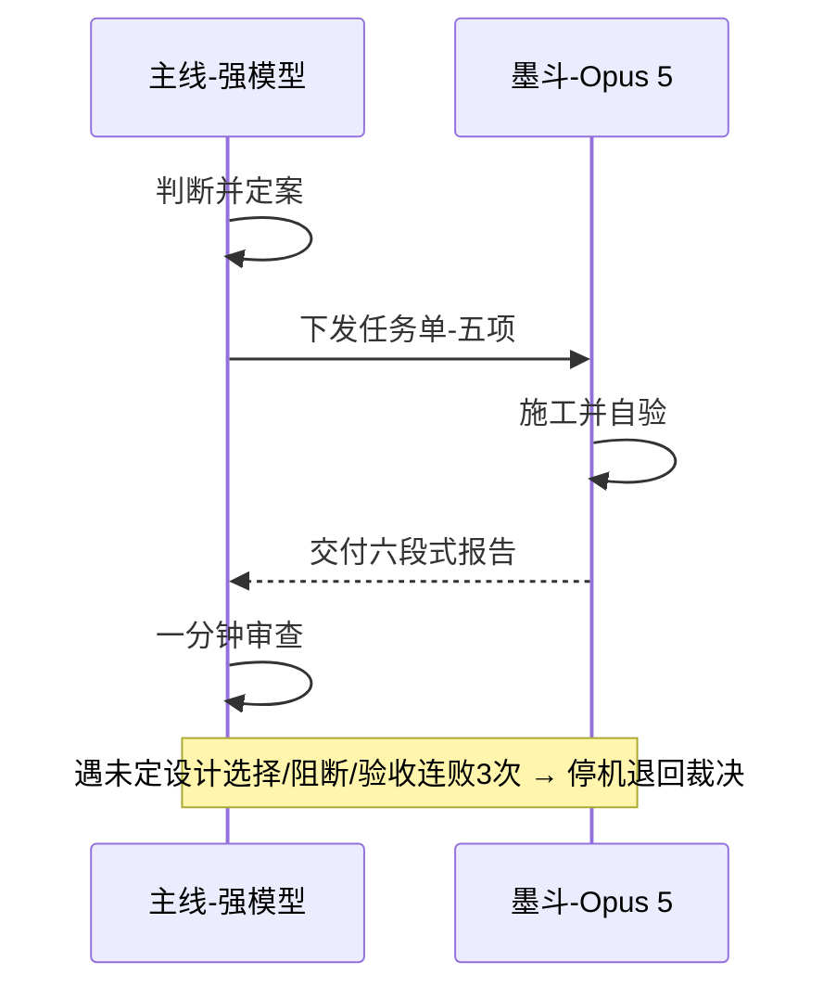
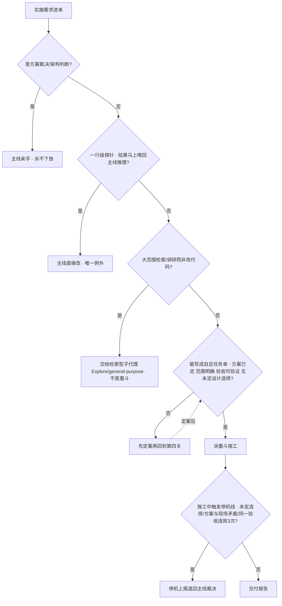
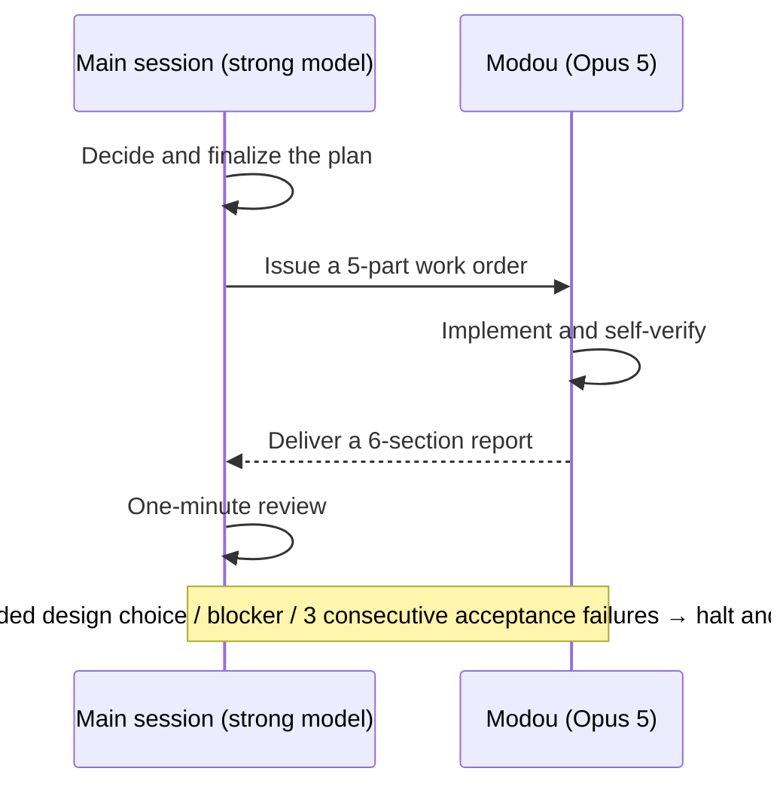

# 墨斗 Mòdǒu — Claude Code 双模型执行官

**Modou — A Dual-Model Executor Agent for Claude Code**

[中文](#中文) | [English](#english)

---

<a id="中文"></a>

## 中文

主线用强模型（如 Fable 5）做判断与定案，所有已定案的代码实施自动下沉给 Opus 5 执行官——半价施工，且实施过程不污染主线上下文。

**名字由来**：墨斗是木匠弹线定位的工具。主线弹线，工匠照线施工。

### 工作原理



主线只消费一份紧凑报告，实施过程的全部读文件、改代码、跑测试都发生在墨斗的独立上下文里。

### 判断树

一个实施需求进来，主线按五个关口决定谁来做：



### 安装

三选一：

1. **脚本安装**：`bash install.sh`
2. **手动复制**：把 `agents/executor.md` 复制到 `~/.claude/agents/`
3. **让 AI 装**：任意 Claude Code 会话读本仓库，说"照 README 安装"。

生效时机：agent 列表在会话启动时加载，**装完后新开会话才生效**。
项目级安装：放到 `<项目>/.claude/agents/executor.md`（一般不需要，全局即可）。

### 验证

新开一个会话，丢一个小实施任务，例如：

> 在 /tmp/t 写个 hello.py 并跑通。

观察主线是否自动出现对 executor 的委派（会看到 Task/Agent 调用，模型为 `claude-opus-5`）。

### 任务单协议

主线下发的任务单必须写全五项——墨斗不继承主线记忆，任务单是唯一信息通道：

| # | 项 | 内容 |
|---|---|---|
| 1 | 已定方案 | 做什么、怎么做（裁决结果，不可偏离） |
| 2 | 范围 | 涉及的文件/模块 + 明确不许碰的部分 |
| 3 | 验收标准 | 哪些测试要过、lint 干净、行为描述 |
| 4 | 相关文件路径 | 精确到路径 |
| 5 | 验证命令与环境坑 | 验收怎么跑（具体命令）+ 已知环境陷阱 |

墨斗交付固定的六段式报告，供主线一分钟审查：

| 段 | 用途 |
|---|---|
| 状态 | 完成 / 部分完成 / 阻断 / 待裁决 |
| 改动摘要 | 每个文件一行：路径 + 改了什么 + 大致行数 |
| 关键 diff | 只贴值得过目的核心片段，绝不粘整个文件 |
| 验证结果 | 跑了什么命令、结果如何；失败原样贴报错 |
| 高危标注 | 删数据/迁移/公开接口/依赖升级单独列出，无则写"无" |
| 偏离与待裁决 | 与任务单的偏离、发现的未定设计选择，无则写"无" |

### 主线侧使用约定

1. **委派判据**：方案已定 + 范围明确 + 验收可验证 → 委派；一行级探针改动、方案裁决、架构判断 → 主线自己做。
2. **任务单五项写全**：尤其第 5 项"验证命令与环境坑"——墨斗不继承主线记忆（例：某目录构建慢需先拷到本地临时目录再做），任务单是唯一信息通道。
3. **返工续同一个 executor**：主线审查发现问题时续原 agent（保留它的实施上下文），不要新开一个从零读文件。
4. **高危项主线复跑**：报告里有"高危标注"（删数据/迁移/公开接口/依赖升级）时，主线必须亲自重跑验收命令后才放行——报告是自述，不是证据。
5. **成本直觉**：Opus 5 是 Fable 5 半价，且实施过程不进主线上下文，会话越长省得越多。

### 成本

- Opus 5 为 Fable 5 半价：**$5 / $25** 每百万 token（输入/输出），对比 Fable 5 的 $10 / $50，同 tokenizer。
- 实施过程的全部 token 不进主线上下文，会话越长省得越多。

### 管理后台

仓库自带一个零依赖的本地管理后台（Python 3 标准库，单文件），提供两大功能：

```bash
python3 admin/modou_admin.py          # 默认 http://127.0.0.1:8848
```

**1. 消耗检查** —— 直接解析本机 Claude Code 的会话记录（`~/.claude/projects/**/*.jsonl`），无需 API key：

- 按 **昨天 / 本周 / 本月**（以及今天、全部）统计 token 消耗与费用；
- **调配情况**：主线 vs 墨斗的花费对比、委派率（按输出 token）、"墨斗为你省下"金额（对比全部由主模型施工的假想费用）；
- 按模型明细（输入/输出/缓存读/缓存写/费用）与每日费用柱状图；
- 费用按内置价格表计算（缓存写 1.25×/2×、缓存读 0.1× 输入价）。

**2. 模型设置**：

- **主模型**：默认勾选"自动选择最贵"（当前即 Fable 5，$10/$50），也可手动指定；写入 `~/.claude/settings.json` 的 `model` 字段。
- **执行官（墨斗）模型**：手动下拉选择（当前推荐 Opus 5），写入 `executor.md` 的 frontmatter，新开会话生效。
- 若执行官不便宜于主模型，页面会警告"同级转包纯增开销"。

另附健康检查（执行官是否安装、用量目录是否存在）和内置价格表。后台只监听 127.0.0.1，不联网、不读写任何密钥。

### 实测记录（2026-07-20）

| 轮次 | 考点 | 结果 |
|---|---|---|
| 1 | 规范任务单 → 落地 + 自验 | ✅ 7 用例全过，主动规避 Python round() 银行家舍入坑 |
| 2 | 埋雷（对账 CSV 退款口径未定）| ✅ 停下退"待裁决"，列 3 口径 + 源数据事实，未替主线拍板 |
| 3 | 裁决下达 → 精准返工 | ✅ 只动授权文件，净额/剔除逻辑复跑无误 |

三轮合计约 14 万 token，全部按 Opus 半价执行；主线仅消费三份摘要报告。

### 前提

- 主线模型须**强于** Opus 5——否则是同级转包，纯增开销。
- 账号须可用 model id `claude-opus-5`。

### 仓库结构

```
.
├── README.md            # 本文件
├── install.sh           # 一键安装脚本（复制 agent 到 ~/.claude/agents/）
├── admin/
│   └── modou_admin.py   # 管理后台：消耗检查 + 模型设置（零依赖，本地运行）
└── agents/
    └── executor.md      # 墨斗执行官的 agent 定义（核心文件）
```

---

<a id="english"></a>

## English

**Modou** (墨斗, *mòdǒu*) is a dual-model executor agent for [Claude Code](https://claude.com/claude-code). The main session runs on a stronger model (e.g. Fable 5) and handles all judgment and decision-making; every piece of *already-decided* implementation work is automatically delegated to an Opus 5 executor agent — built at half the price, without polluting the main session's context.

**About the name**: A *modou* (ink line marker) is the carpenter's tool for snapping a straight chalk line. The main session snaps the line; the craftsman builds along it.

### How it works



The main session consumes only one compact report. All the file reading, code editing, and test running of the implementation happens inside Modou's own isolated context.

### Decision tree

When an implementation request comes in, the main session routes it through five gates:

1. **Is it a design ruling or architectural judgment?** → The main session does it itself. Never delegated.
2. **Is it a one-line probe whose result feeds straight back into the main session's reasoning?** → The main session edits directly. The only exception.
3. **Is it broad search/research rather than code changes?** → Hand it to a search-oriented subagent (Explore / general-purpose), not Modou.
4. **Can it be written as a self-contained work order** (plan finalized, scope explicit, acceptance verifiable, no undecided design choices)? → If not, finalize the plan first, then come back to this gate. If yes, dispatch Modou.
5. **During implementation, does it hit a stop line** (undecided choice, plan contradicts reality on the ground, same acceptance check fails 3 times in a row)? → Halt, report, and escalate back to the main session for a ruling. Otherwise, deliver the report.

### Installation

Pick any of the three:

1. **Script**: `bash install.sh`
2. **Manual copy**: copy `agents/executor.md` into `~/.claude/agents/`
3. **Let the AI install it**: point any Claude Code session at this repo and say "install per the README".

When it takes effect: the agent list is loaded at session startup, so **open a new session after installing**.
Project-level install: place it at `<project>/.claude/agents/executor.md` (usually unnecessary — global is fine).

### Verify the install

Open a fresh session and toss in a small implementation task, e.g.:

> Write a hello.py under /tmp/t and make it run.

Watch whether the main session automatically delegates to the executor (you'll see a Task/Agent call with model `claude-opus-5`).

### The work-order protocol

Every work order issued by the main session must contain all five parts — Modou does not inherit the main session's memory; the work order is the only information channel:

| # | Part | Content |
|---|---|---|
| 1 | Finalized plan | What to do and how (the ruling — no deviation allowed) |
| 2 | Scope | Files/modules involved + parts explicitly off-limits |
| 3 | Acceptance criteria | Which tests must pass, lint clean, behavioral description |
| 4 | Relevant file paths | Exact paths |
| 5 | Verification commands & environment pitfalls | How to run acceptance (exact commands) + known environment traps |

Modou always delivers a fixed six-section report, designed for a one-minute review:

| Section | Purpose |
|---|---|
| Status | Done / Partially done / Blocked / Awaiting ruling |
| Change summary | One line per file: path + what changed + rough line count |
| Key diffs | Only the core snippets worth a look — never a whole file |
| Verification results | What commands ran and how they went; failures pasted verbatim |
| High-risk flags | Data deletion / migrations / public-API changes / dependency upgrades listed separately; "none" otherwise |
| Deviations & pending rulings | Any departure from the work order; any undecided design choices discovered; "none" otherwise |

### Conventions on the main-session side

1. **Delegation criteria**: plan finalized + scope explicit + acceptance verifiable → delegate. One-line probe edits, design rulings, and architectural judgment → the main session does them itself.
2. **Fill in all five parts of the work order** — especially part 5, "verification commands & environment pitfalls". Modou does not inherit the main session's memory (e.g. "this directory builds slowly; copy it to a local temp dir first"); the work order is the only channel.
3. **Rework continues on the same executor**: when review finds a problem, continue the original agent (it keeps its implementation context) instead of spawning a fresh one that re-reads everything from zero.
4. **Re-run high-risk items yourself**: if the report carries any high-risk flag (data deletion / migration / public API / dependency upgrade), the main session must personally re-run the acceptance commands before sign-off — a report is self-testimony, not evidence.
5. **Cost intuition**: Opus 5 runs at half the price of Fable 5, and none of the implementation tokens enter the main session's context — the longer the session, the more you save.

### Cost

- Opus 5 is half the price of Fable 5: **$5 / $25** per million tokens (input/output), vs. Fable 5's $10 / $50, with the same tokenizer.
- All implementation tokens stay out of the main session's context; longer sessions save more.

### Admin console

The repo ships a zero-dependency local admin console (single file, Python 3 standard library only) with two main features:

```bash
python3 admin/modou_admin.py          # defaults to http://127.0.0.1:8848
```

**1. Usage check** — parses your local Claude Code session records (`~/.claude/projects/**/*.jsonl`) directly; no API key required:

- Token usage and cost by **yesterday / this week / this month** (plus today and all-time);
- **Delegation overview**: main session vs. Modou spend, delegation ratio (by output tokens), and "saved by Modou" — the difference versus the hypothetical cost of running all implementation on the main model;
- Per-model breakdown (input / output / cache read / cache write / cost) and a daily cost bar chart;
- Costs computed from a built-in price table (cache write at 1.25×/2×, cache read at 0.1× of the input price).

**2. Model settings**:

- **Main model**: "auto-select the most expensive" is checked by default (currently Fable 5, $10/$50); manual selection is also available. Written to the `model` field of `~/.claude/settings.json`.
- **Executor (Modou) model**: manual dropdown (Opus 5 is the current recommendation), written into the frontmatter of `executor.md`; takes effect in new sessions.
- If the executor is not cheaper than the main model, the page warns that peer-to-peer subcontracting is pure overhead.

Also includes a health check (executor installed? usage directory present?) and the built-in price table. The console binds to 127.0.0.1 only — no network calls, no secrets touched.

### Field-test log (2026-07-20)

| Round | What was tested | Result |
|---|---|---|
| 1 | Well-formed work order → implementation + self-verification | ✅ All 7 test cases passed; proactively avoided Python `round()`'s banker's-rounding trap |
| 2 | Planted trap (refund semantics in a reconciliation CSV left undecided) | ✅ Halted with "awaiting ruling", listed 3 candidate semantics + facts from the source data, did not decide on the main session's behalf |
| 3 | Ruling issued → precise rework | ✅ Touched only the authorized files; net-amount/exclusion logic re-verified clean |

Roughly 140k tokens across the three rounds, all billed at Opus half-price; the main session consumed only three summary reports.

### Prerequisites

- The main-session model must be **stronger than** Opus 5 — otherwise it's peer-to-peer subcontracting, pure overhead.
- Your account must have access to model id `claude-opus-5`.

### Repository layout

```
.
├── README.md            # This file
├── install.sh           # One-shot installer (copies the agent into ~/.claude/agents/)
├── admin/
│   └── modou_admin.py   # Admin console: usage check + model settings (zero-dependency, local)
└── agents/
    └── executor.md      # The Modou executor agent definition (the core file)
```

---

License: TBD / 待定
